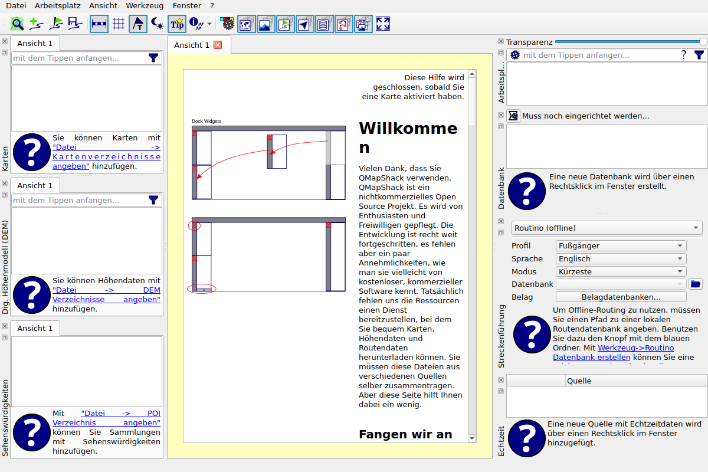

# Das Hauptfenster

Diese Seite zeigt das QMapShack-Fenster, wie Sie es beim ersten Start sehen, und wofür seine Teile da sind.

```{index} single: Hauptfenster
```

## Das Fenster beim ersten Start



Die Karte nimmt die Mitte des Fensters ein, darüber liegen die Menüleiste und die Werkzeugleiste.

Beim ersten Start ist keine Karte aktiv, deshalb steht dort eine Begrüßungsseite. Sie schließt sich, sobald Sie
eine Karte einschalten.

Die Bereiche links und rechts der Karte sind anfangs größtenteils leer; die meisten zeigen einen Hinweis, wie Sie
sie füllen:

- **Karten**: Karten ein- und ausschalten.
- **Dig. Höhenmodell (DEM)**: Höhendaten ein- und ausschalten, zum Beispiel um das Gelände auf der Karte zu
    schummern.
- **Sehenswürdigkeiten**: Sehenswürdigkeiten aus POI-Dateien anzeigen.
- **Arbeitsplatz**: die Projekte, die Sie geöffnet haben, mit ihren Tracks, Wegpunkten, Routen und Gebieten.
- **Datenbank**: Ihre Projekte in einer Datenbank speichern.
- **Streckenführung**: einstellen, wie QMapShack Routen berechnet.
- **Echtzeit**: Live-Positionen anzeigen, zum Beispiel von Schiffen oder Flugzeugen.

Für den Schnellstart brauchen Sie **Sehenswürdigkeiten** und **Echtzeit** nicht.

```{index} single: Bereich; verschieben
```

```{index} single: Bereich; stapeln
```

```{index} single: Bereich; Größe ändern
```

```{index} single: Bereich; schließen
```

## Das Fenster anordnen

Jeder Bereich hat am linken Rand eine Titelleiste mit seinem Namen.

- ```{image} ../images/quickstart-main-window/quickstart-main-window-panel-move.png
    :align: right
    ```

    Um einen Bereich zu verschieben, ziehen Sie ihn an seiner Titelleiste. Sie können ihn links, rechts, über oder
    unter der Karte ablegen.

- ```{image} ../images/quickstart-main-window/quickstart-main-window-panel-stack.png
    :align: right
    ```

    Um Bereiche zu stapeln, legen Sie einen Bereich auf einem anderen ab. Über Reiter wechseln Sie dann zwischen ihnen.

- ```{image} ../images/quickstart-main-window/quickstart-main-window-panel-resize.png
    :align: right
    ```

    Um die Größe eines Bereichs zu ändern, ziehen Sie die Trennlinie zwischen zwei Bereichen oder zwischen einem
    Bereich und der Karte.

- ```{image} ../images/quickstart-main-window/quickstart-main-window-panel-buttons.png
    :align: right
    ```

    Um einen Bereich zu schließen, den Sie nicht brauchen, klicken Sie auf den oberen Knopf seiner
    Titelleiste. Der Knopf darunter löst den Bereich aus dem Fenster.

```{index} single: Bereich; wieder anzeigen
```

```{index} single: Vollbild
```

```{index} single: Fenster; umschalten
```

```{index} single: Bereich; alle ausblenden
```

## Einen Bereich zurückholen

- ```{image} ../images/quickstart-main-window/quickstart-main-window-menu-window.png
    :align: right
    ```

    Um einen geschlossenen Bereich wieder anzuzeigen, klicken Sie auf seinen Namen im Menü **Fenster**. Das Menü
    führt jeden Bereich und die Werkzeugleiste auf und hebt die sichtbaren hervor.

- Um alle Bereiche auf einmal auszublenden, klicken Sie auf **Fenster → Fenster umschalten** oder drücken
    **Strg+D**; das Menü nennt die Bereiche hier Fenster. Wiederholen Sie das, um sie zurückzuholen.
- Um der Karte den ganzen Bildschirm zu geben, klicken Sie auf **Fenster → Vollbild** oder drücken **F11**. Das
    Vollbild blendet auch die Menüleiste aus, verlassen Sie es also mit **F11**.

QMapShack merkt sich Ihre Anordnung für den nächsten Start.

```{index} single: Hauptverzeichnis
```

## Das Hauptverzeichnis einrichten

QMapShack speichert seine Daten in einem Verzeichnis, mit einem Unterverzeichnis für jede Art von Daten: `Maps`, `DEM`,
`POI`, `Routino` und `BRouter` (Daten für die Streckenführung), `Databases` und `GPX`. Die Begrüßungsseite richtet
es für Sie ein, und die anderen Seiten des Schnellstarts legen ihre Daten dort ab.

1. ```{image} ../images/quickstart-main-window/quickstart-main-window-give-it-a-home.png
    :align: right
    ```

    Scrollen Sie auf der Begrüßungsseite nach unten bis zu **Wählen Sie ein Hauptverzeichnis** und klicken Sie
    auf den Link **Pfad**.

2. Wählen Sie ein Verzeichnis aus oder legen Sie ein neues an, und bestätigen Sie.
3. QMapShack legt die fehlenden Unterverzeichnisse an und meldet sie für Karten, Höhendaten, POIs und die
    Streckenführung an. Die Begrüßungsseite zeigt das Verzeichnis dann unter **Aktuelles Hauptverzeichnis**.
