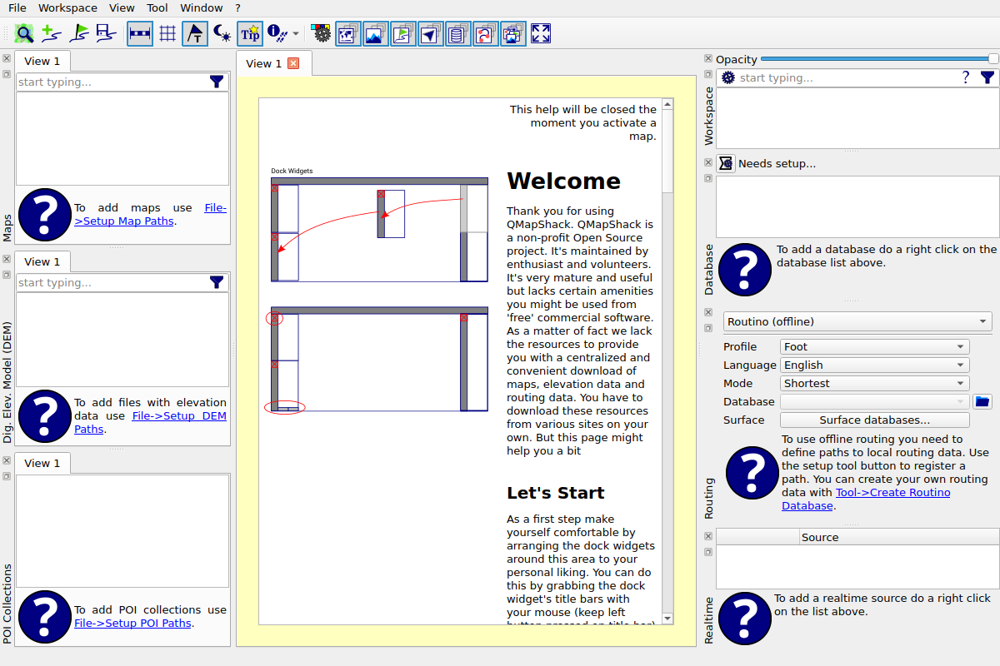

# The main window

This page shows the QMapShack window as you see it on first start, and what each part of it is for.

```{index} single: Main window
```

## The window on first start



The map takes up the middle of the window, with the menu bar and the toolbar above it.

On first start, no map is active, so a welcome page appears instead. It closes once you activate a map.

The panels to the left and right of the map are mostly empty initially. Many display hints explain how to populate them:

- **Maps**: activate or deactivate maps.
- **Dig. Elev. Model (DEM)**: activate or deactivate elevation data, for example, to add terrain shading to the map.
- **POI Collections**: show points of interest from POI files.
- **Workspace**: Your open projects, including their tracks, waypoints, routes, and areas.
- **Database**: keep your projects in a database.
- **Routing**: set up how QMapShack calculates routes.
- **Realtime**: show live positions, for example of ships or aircraft.

The Quick Start doesn't cover **POI Collections** and **Realtime**.

```{index} single: Panel; move
```

```{index} single: Panel; stack
```

```{index} single: Panel; resize
```

```{index} single: Panel; close
```

## Arranging the window

Each panel has a title bar displaying its name on the left edge.

- ```{image} ../images/quickstart-main-window/quickstart-main-window-panel-move.png
    :align: right
    ```

    To move a panel, drag its title bar. You can drop it to the left, right, above, or below the map.

- ```{image} ../images/quickstart-main-window/quickstart-main-window-panel-stack.png
    :align: right
    ```

    To stack panels, drag one panel onto another. Use the tabs to switch between the stacked panels.

- ```{image} ../images/quickstart-main-window/quickstart-main-window-panel-resize.png
    :align: right
    ```

    To resize a panel, drag the border between two panels or between a panel and the map.

- ```{image} ../images/quickstart-main-window/quickstart-main-window-panel-buttons.png
    :align: right
    ```

    To close a panel you no longer need, click the top button in its title bar. The button below it detaches the panel from the main window.

```{index} single: Panel; show again
```

```{index} single: Fullscreen
```

```{index} single: Dock; toggle
```

```{index} single: Panel; hide all
```

## Restoring a panel

- ```{image} ../images/quickstart-main-window/quickstart-main-window-menu-window.png
    :align: right
    ```

    To show a closed panel again, click its name in the **Window** menu. The menu lists all panels and the toolbar, highlighting those currently visible.
- To hide all panels at once, select **Window → Toggle Docks** or press **Ctrl+D**. The menu refers to panels as docks. Repeat the action to show them again.
- To give the map the entire screen, select **Window → Fullscreen** or press **F11**. The fullscreen mode also hides the menu bar. Press **F11** again to exit the fullscreen mode.

QMapShack saves your panel arrangement and restores it the next time you start the application.


```{index} single: Home folder
```

## Setting up the home folder

QMapShack stores all its data in a single folder, with a separate subfolder for each data type: `Maps`, `DEM`, `POI`, `Routino` and `BRouter` (routing data), `Databases`, and `GPX`. The welcome page sets up this folder structure for you, and the other Quick Start pages store their data there.

1. ```{image} ../images/quickstart-main-window/quickstart-main-window-give-it-a-home.png
    :align: right
    ```

    Scroll down the welcome page to **Give it a home**, then click the **path** link.

2. Select a folder, or create a new one, and confirm.
3. QMapShack creates any missing subfolders and registers them for maps, elevation data, POIs, and routing data. The welcome page then displays the folder under **Current home**.