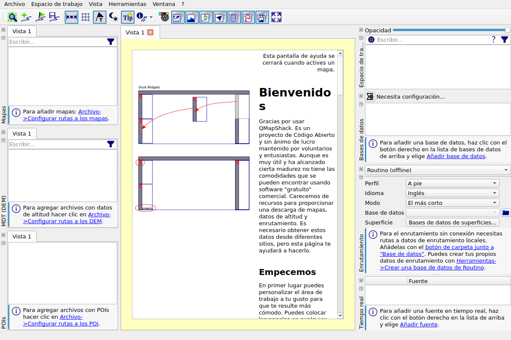

# La ventana principal

Esta página muestra la ventana de QMapShack tal como la ves en el primer inicio, y para qué sirve cada parte.

```{index} single: Ventana principal
```

## La ventana en el primer inicio



El mapa ocupa el centro de la ventana, con la barra de menús y la barra de herramientas encima.

En el primer inicio no hay ningún mapa activo, así que en su lugar aparece una página de bienvenida. Se cierra en
cuanto activas un mapa.

Al principio, los paneles a izquierda y derecha del mapa están casi vacíos; muchos muestran una indicación de cómo
llenarlos:

- **Mapas**: activar y desactivar mapas.
- **MDT (DEM)**: activar y desactivar datos de altitud, por ejemplo para sombrear el terreno en el mapa.
- **POIs**: mostrar puntos de interés de archivos POI.
- **Espacio de trabajo**: los proyectos que tienes abiertos, con sus tracks, waypoints, rutas y áreas.
- **Bases de datos**: guardar tus proyectos en una base de datos.
- **Enrutamiento**: configurar cómo calcula QMapShack las rutas.
- **Tiempo real**: mostrar posiciones en directo, por ejemplo de barcos o aviones.

El inicio rápido no necesita **POIs** ni **Tiempo real**.

```{index} single: Panel; mover
```

```{index} single: Panel; apilar
```

```{index} single: Panel; cambiar el tamaño
```

```{index} single: Panel; cerrar
```

## Ordenar la ventana

Cada panel tiene en su borde izquierdo una barra de título con su nombre.

- ```{image} ../images/quickstart-main-window/quickstart-main-window-panel-move.png
    :align: right
    ```

    Para mover un panel, arrástralo por su barra de título. Puedes soltarlo a la izquierda, a la derecha, encima o
    debajo del mapa.

- ```{image} ../images/quickstart-main-window/quickstart-main-window-panel-stack.png
    :align: right
    ```

    Para apilar paneles, suelta un panel sobre otro. Después cambia de uno a otro con las pestañas.

- ```{image} ../images/quickstart-main-window/quickstart-main-window-panel-resize.png
    :align: right
    ```

    Para cambiar el tamaño de un panel, arrastra el borde entre dos paneles o entre un panel y el mapa.

- ```{image} ../images/quickstart-main-window/quickstart-main-window-panel-buttons.png
    :align: right
    ```

    Para cerrar un panel que no necesitas, haz clic en el botón superior de su barra de título. El botón de debajo
    separa el panel de la ventana.

```{index} single: Panel; volver a mostrar
```

```{index} single: Pantalla completa
```

```{index} single: Panel; alternar
```

```{index} single: Panel; ocultar todos
```

## Recuperar un panel

- ```{image} ../images/quickstart-main-window/quickstart-main-window-menu-window.png
    :align: right
    ```

    Para volver a mostrar un panel cerrado, haz clic en su nombre en el menú **Ventana**. El menú lista todos los
    paneles y la barra de herramientas, y resalta los que están en pantalla.

- Para ocultar todos los paneles a la vez, haz clic en **Ventana → Mostrar/ocultar paneles** o pulsa **Ctrl+D**.
    Repite lo mismo para que vuelvan.
- Para dar toda la pantalla al mapa, haz clic en **Ventana → Pantalla completa** o pulsa **F11**. La pantalla
    completa oculta también la barra de menús, así que pulsa **F11** para salir.

QMapShack guarda tu distribución para el próximo inicio.

```{index} single: Carpeta principal
```

## Configurar la carpeta principal

QMapShack guarda sus datos en una carpeta, con una subcarpeta para cada tipo de datos: `Maps`, `DEM`, `POI`, `Routino`
y `BRouter` (datos de enrutamiento), `Databases` y `GPX`. La página de bienvenida la crea por ti, y las demás páginas
del inicio rápido guardan sus datos ahí.

1. ```{image} ../images/quickstart-main-window/quickstart-main-window-give-it-a-home.png
    :align: right
    ```

    Desplázate por la página de bienvenida hasta **Almacenar los datos** y haz clic en el enlace
    **una carpeta raíz**.

2. Selecciona una carpeta, o crea una nueva, y confirma.
3. QMapShack crea las subcarpetas que faltan y las registra para mapas, datos de altitud, POIs y enrutamiento.
    Después, la página de bienvenida muestra la carpeta en **Carpeta principal actual**.
