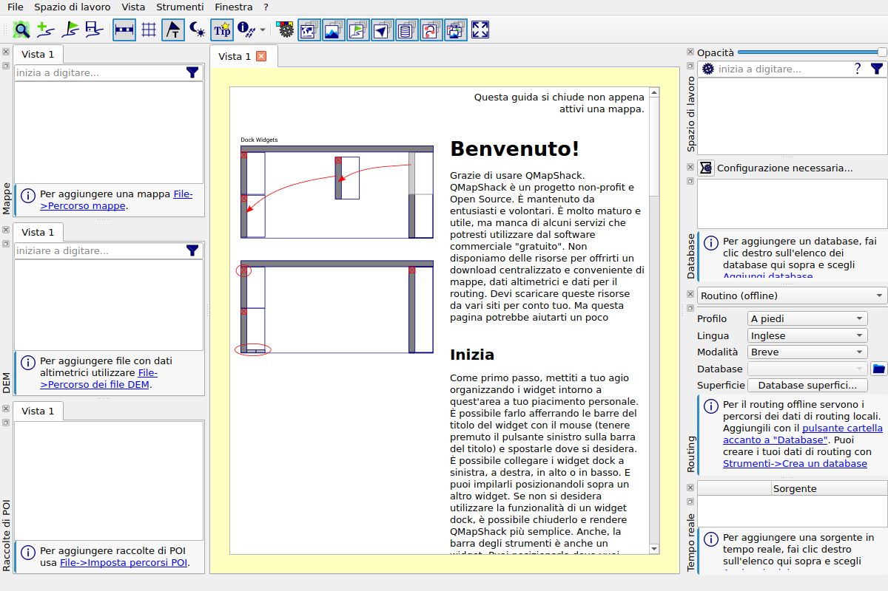

# La finestra principale

Questa pagina mostra la finestra di QMapShack come la vedi al primo avvio, e a cosa serve ciascuna delle sue parti.

```{index} single: Finestra principale
```

## La finestra al primo avvio



La mappa occupa il centro della finestra, con la barra dei menu e la barra degli strumenti sopra.

Al primo avvio nessuna mappa è attiva, quindi al suo posto appare una pagina di benvenuto. Scompare non appena attivi
una mappa.

All'inizio i riquadri a sinistra e a destra della mappa sono quasi vuoti; molti mostrano un suggerimento su come
riempirli:

- **Mappe**: attivare e disattivare le mappe.
- **DEM**: attivare e disattivare i dati altimetrici, per esempio per ombreggiare il rilievo sulla mappa.
- **Raccolte di POI**: mostrare punti di interesse da file POI.
- **Spazio di lavoro**: i progetti che hai aperto, con le loro tracce, waypoint, itinerari e aree.
- **Database**: conservare i tuoi progetti in un database.
- **Routing**: impostare come QMapShack calcola gli itinerari.
- **Tempo reale**: mostrare posizioni in diretta, per esempio di navi o aerei.

La guida rapida non ha bisogno di **Raccolte di POI** e **Tempo reale**.

```{index} single: Riquadro; spostare
```

```{index} single: Riquadro; impilare
```

```{index} single: Riquadro; ridimensionare
```

```{index} single: Riquadro; chiudere
```

## Disporre la finestra

Lungo il bordo sinistro di ogni riquadro c'è una barra del titolo con il suo nome.

- ```{image} ../images/quickstart-main-window/quickstart-main-window-panel-move.png
    :align: right
    ```

    Per spostare un riquadro, trascinalo tenendolo per la barra del titolo. Puoi rilasciarlo a sinistra, a destra,
    sopra o sotto la mappa.

- ```{image} ../images/quickstart-main-window/quickstart-main-window-panel-stack.png
    :align: right
    ```

    Per impilare i riquadri, rilascia un riquadro sopra un altro. Poi passa dall'uno all'altro con le schede.

- ```{image} ../images/quickstart-main-window/quickstart-main-window-panel-resize.png
    :align: right
    ```

    Per ridimensionare un riquadro, trascina il bordo tra due riquadri, o tra un riquadro e la mappa.

- ```{image} ../images/quickstart-main-window/quickstart-main-window-panel-buttons.png
    :align: right
    ```

    Per chiudere un riquadro che non ti serve, fai clic sul pulsante superiore nella barra del titolo. Il pulsante
    sottostante sgancia il riquadro dalla finestra.

```{index} single: Riquadro; mostrare di nuovo
```

```{index} single: Schermo intero
```

```{index} single: Riquadro; attivare e disattivare
```

```{index} single: Riquadro; nascondere tutti
```

## Recuperare un riquadro

- ```{image} ../images/quickstart-main-window/quickstart-main-window-menu-window.png
    :align: right
    ```

    Per mostrare di nuovo un riquadro chiuso, fai clic sul suo nome nel menu **Finestra**. Il menu elenca tutti i
    riquadri e la barra degli strumenti, ed evidenzia quelli visibili sullo schermo.

- Per nascondere tutti i riquadri in una volta, fai clic su **Finestra → Attiva/disattiva riquadri** o premi
    **Ctrl+D**. Ripeti la stessa operazione per farli ricomparire.
- Per dare tutto lo schermo alla mappa, fai clic su **Finestra → Schermo intero** o premi **F11**. Lo schermo intero
    nasconde anche la barra dei menu, quindi premi **F11** per uscirne.

QMapShack conserva la tua disposizione per il prossimo avvio.

```{index} single: Cartella home
```

## Impostare la cartella home

QMapShack conserva i suoi dati in una cartella, con una sottocartella per ogni tipo di dati: `Maps`, `DEM`, `POI`,
`Routino` e `BRouter` (dati di routing), `Databases` e `GPX`. La pagina di benvenuto la prepara per te, e le altre
pagine della guida rapida vi mettono i loro dati.

1. ```{image} ../images/quickstart-main-window/quickstart-main-window-give-it-a-home.png
    :align: right
    ```

    Scorri la pagina di benvenuto fino a **Dagli una casa** e fai clic sul collegamento **percorso**.

2. Seleziona una cartella, o creane una nuova, e conferma.
3. QMapShack crea le sottocartelle che mancano e le registra per mappe, dati altimetrici, POI e routing. Poi la
    pagina di benvenuto mostra la cartella sotto **Home attuale**.
